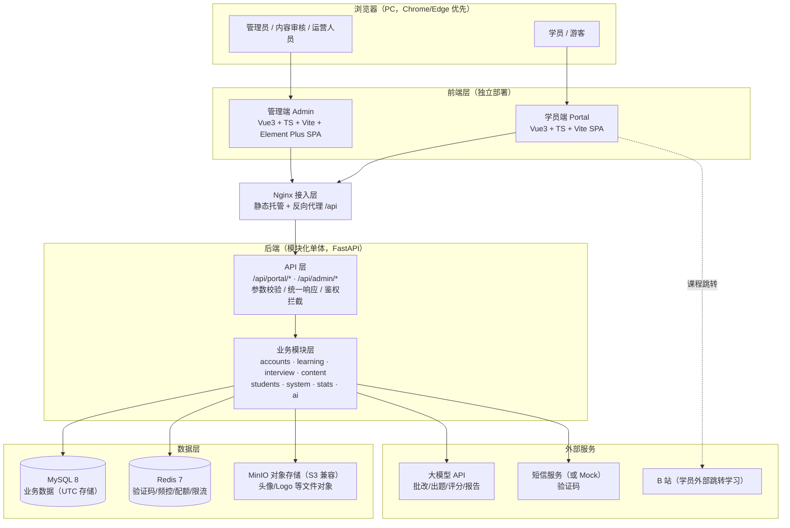
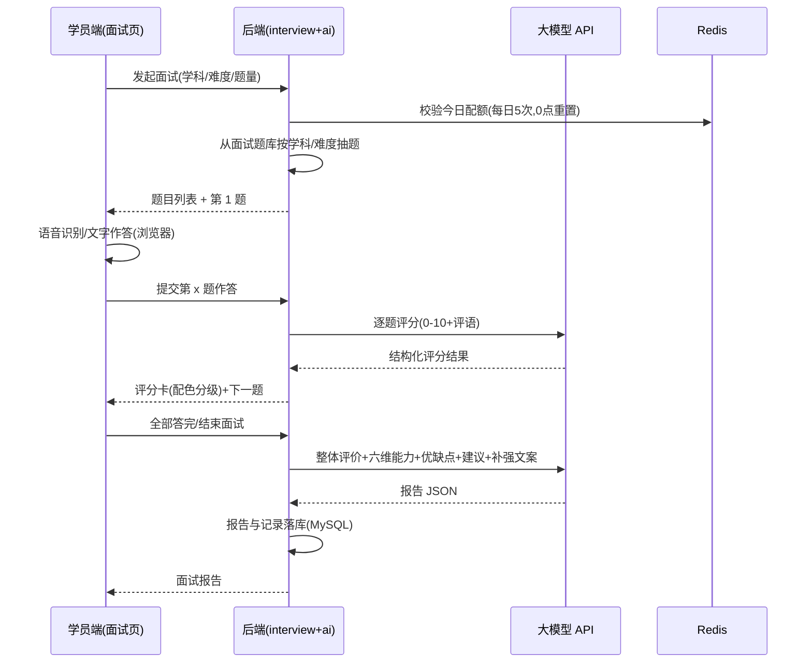
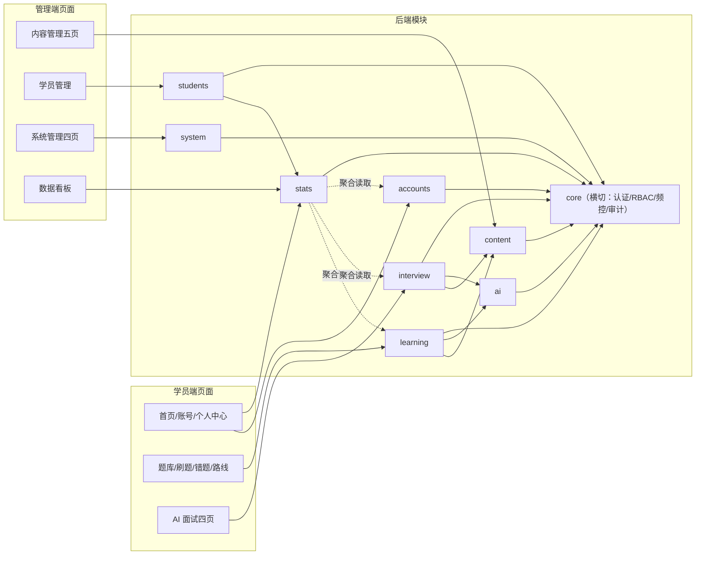

# 云枢智学 —— 整体架构设计

> 阶段：设计第二阶段（技术选型与整体架构设计）
> 依据：`docs/design/01.功能模块梳理.md`（第一阶段，已全部确认闭环）、`docs/云枢智学-需求文档.md`（权威需求来源）、`prototype/`（25 页已验收原型）、`docs/rules/database-rules.md`、`docs/rules/api-rules.md`
> 范围：技术选型、整体架构与分层、模块架构、项目目录规划、关键设计决策与风险。
> 不涉及：具体表结构（→ `03.数据库设计.md`）、接口定义（→ `04.API接口设计.md`）、业务代码。
> **标记约定**：
> - ✅ = 已确认（第一阶段 / 需求文档定稿 / 规则文件规定），直接遵循；
> - 【建议 Pn · 待确认】= 本文提出的建议方案，附依据，待用户确认后转为定案（Pn 为本文待确认问题编号，见 §6）；
> - 【决策】= 以既有规则或已确认需求为依据的默认技术选择，如无异议按此执行（如有异议请在审核时指出）。
>
> 说明：01 与需求文档中引用过「03 course 表」「04 附录 A 权限码」等早期设计文档内容，但当前 `docs/design/` 下仅有 01。本文按当前仓库状态重新推导架构，并保留其中已明确记录的确认结论（如安全与频控 T6 阈值、权限树 9 组 33 项等）。

---

## 1. 技术选型

### 1.1 既有约束（选型必须遵循）

| # | 约束 | 来源 |
|---|---|---|
| 1 | 学员端（Portal）与管理端（Admin）**独立部署**，两端登录态独立 | 需求文档 1、3.2 / C3 |
| 2 | 数据库对象 `snake_case`、自增主键、**禁止物理外键**、逻辑关联由应用层维护、UTC 存储等 | docs/rules/database-rules.md |
| 3 | 默认 REST 风格 HTTP API；统一响应结构；HTTP 状态码与业务错误码分离 | docs/rules/api-rules.md |
| 4 | 删除均为**逻辑删除**；导出为**同步下载**（CSV / Excel 流），不建任务表 | 需求 §6、B5、4.4 |
| 5 | 练习进度、面试会话**前端本地持久化**（localStorage），面试报告/记录落服务端 | 需求 3.5、3.8.2 |
| 6 | 阈值类参数（默认题量、单问超时 5 分钟、每日配额 5 次、错题分级、简答 ≥6 分等）为**固定常量**，不做成可配置 | C5 |
| 7 | 安全与频控纳入本期（登录失败锁定、验证码频控、接口限流），阈值已定稿 | 需求 3.2（架构阶段 T6 已确认） |
| 8 | 管理端 RBAC 权限树 **9 组 33 项**；预置 3 角色；超级管理员内置唯一 | A4/A5、需求 4.5.2 |
| 9 | UI 交互与页面结构以已验收原型 `prototype/` 为基准 | 阶段一结论 |
| 10 | 短信验证码、第三方登录入口、语音识别/播报在需求中出现，但**真实外部服务接入方式未定** | 见 §6 P6/P7 |

> 备注：项目位于 `py_project` 工作区，暗示 Python 技术栈倾向，但文档中无明文技术约束，**仅作倾向参考**，最终以 P1 确认为准。

### 1.2 选型总览

| 层面 | 选型 | 状态 | 核心依据（摘要） |
|---|---|---|---|
| 前端框架（双端） | Vue 3 + TypeScript + Vite | ✅ 已确认（P2） | 双 SPA 独立部署；原型交互密集、组件化需求高；国内生态成熟 |
| 前端 UI 组件库 | Element Plus（管理端为主，学员端同栈并按原型定制主题） | ✅ 已确认（P2） | 管理端 12 页以表格/表单/树/上传/导入向导为主，组件库收益最大 |
| 图表 | ECharts 5 | 【决策】 | 首页柱状图、报告雷达/环形图、看板折线/分布图，ECharts 覆盖全部图型 |
| 语音 | 浏览器 Web Speech API（SpeechRecognition 识别 + speechSynthesis 播报） | 【决策】 | 需求 3.8.2 明确「浏览器语音识别」、播报开关/重播；原型即用浏览器 API，无需服务端 ASR |
| 后端语言/框架 | Python 3.11+ / FastAPI + SQLAlchemy 2.x + Pydantic v2 | ✅ 已确认（P1） | AI 能力层是平台核心，Python 对接 LLM/Excel 生态最顺；FastAPI 异步适合 AI 长耗时调用，自动 OpenAPI 便于按 api-rules 出接口文档 |
| 数据库 | MySQL 8.0（InnoDB，utf8mb4） | ✅ 已确认（P3） | 强结构化业务数据（题目/权限/日志）；database-rules 面向关系型；中小规模足够 |
| 缓存 | Redis 7 | ✅ 已确认（P4） | 验证码存储/频控计数/登录锁定/AI 面试每日配额/接口限流均需带 TTL 的计数器与 KV |
| AI 能力层 | 大模型开放 API（供应商可配置，经统一封装调用；联调期 Mock） | ✅ 已确认（P5）：先抽象、供应商暂不定 | 简答批改、面试出题、逐题评分、报告生成均依赖 LLM；供应商后补，先落网关抽象 |
| 短信 | 适配器抽象 + 开发期 Mock，上线前可切真实短信服务商 | ✅ 已确认（P6） | 注册/登录/找回密码依赖手机验证码；服务商报备周期长，先 Mock 不阻塞主链路 |
| Excel 处理 | openpyxl（.xlsx 读写，导入校验/导出生成） | 【决策】 | 三类导入（课程/题库/面试题）+ 三类导出（题目/学员/日志 CSV），Python 生态标准库方案 |
| 认证 | JWT（学员端、管理端两套独立 Token）+ Redis 辅助（频控/锁定/失效） | 【决策】 | 两端独立登录态（C3）；无状态 Token 适配独立部署的双 SPA |
| 文件存储 | **MinIO 对象存储**（S3 兼容，自建），抽象上传接口 | ✅ 已确认（D15 变更，2026-11-23） | 头像、Logo 等文件对象统一存 MinIO，数据库仅存对象 URL；S3 协议可平滑切换 OSS/云存储 |
| 消息队列 | **本期不引入** | 【决策】 | 无异步任务需求（导出已定为同步流）；AI 调用用异步 HTTP + 前端等待态即可，避免过度设计 |
| 部署 | Docker Compose 单机：Nginx + Portal + Admin + API + MySQL + Redis + MinIO | ✅ 已确认（P8，MinIO 2026-11-23 增补） | 双端独立部署约束 + 本期规模；Nginx 统一接入与静态托管 |

### 1.3 选型依据详述

#### 1.3.1 后端：Python + FastAPI【✅ 已确认 P1】

- **AI 密集型应用**：简答批改、面试出题、逐题评分、报告生成、补强建议全部走 LLM，Python 的 LLM SDK / Prompt 工程 / JSON 结构化输出校验生态最成熟。
- **异步友好**：AI 单次调用秒级延迟，面试逐题评分高频发生，FastAPI 原生 async 便于并发等待外部 API，不占用过多线程。
- **契合 api-rules**：Pydantic 天然承担「服务端必须校验所有客户端输入」「参数格式与枚举限制」；自动生成 OpenAPI 文档，便于在 04 阶段产出并核对接口契约。
- **Excel 批处理**：openpyxl 对接需求中复杂的导入校验语义（整份拒绝、行号报错、覆盖更新）成本低。
- **备选对比**：
  - Java Spring Boot：企业级能力强，但本项目无高并发/分布式事务诉求，开发成本与迭代速度不占优；
  - Node.js NestJS：前后端同语言，但 LLM/数据处理生态弱于 Python；
  - Django/DRF：自带 Admin 与成熟 RBAC，但本项目管理端为独立 Vue SPA，Django Admin 用不上，框架偏重。
- 备注：若团队实际以 Java 为主力（信息缺失，需用户确认），则 Spring Boot + MyBatis-Plus 为等价可行替代，架构分层与模块划分不变。

#### 1.3.2 前端：Vue 3 + TypeScript + Vite + Element Plus【✅ 已确认 P2】

- **双端独立部署** → 两个独立 SPA 工程；同技术栈可共享组件、类型与经验，降低双倍维护成本。
- **管理端** 12 页以「筛选 + 表格 + 分页 + 表单弹窗 + 批量操作 + 导入向导 + 权限树」为主，Element Plus 组件覆盖度最高（Table/Tree/Upload/DatePicker/Descriptions）。
- **学员端** 交互偏视觉（首页动效、练习答题卡、面试对话流），同用 Vue3 + Element Plus 基座，按原型设计令牌定制主题，个别页面（对话流、答题卡）自定义组件。
- **TypeScript**：接口契约（04 文档）可生成类型，双端与后端字段对齐，减少联调错误。
- **备选对比**：React + Ant Design 同样可行（生态相当），差异主要在团队熟悉度；若团队更熟 React 可等价替换，不影响整体架构。

#### 1.3.3 数据层：MySQL 8 + Redis 7【✅ 已确认 P3/P4】

- 业务数据强结构化（学科→阶段→题目、课程多对多、RBAC、审计日志），且 database-rules 明确面向关系型设计（自增主键、逻辑外键、唯一约束），选 MySQL 8（utf8mb4）完全覆盖；数据规模（题库 ≤ 万级、用户 ≤ 万级）无压力。
- Redis 的必要性来自**已确认的非功能需求**：
  - 验证码：存储 + 60s 获取频控 + 每日 10 次上限 + 连续 5 次校验失败失效（需求 3.2）；
  - 登录失败锁定：连续 5 次错误锁 5 分钟（计数 + TTL）；
  - AI 面试每日配额：每日 5 次、次日 0 点重置（日期键 + TTL）；
  - 关键接口 IP + 账号双维度限流。
  这些都是带过期时间的计数/KV 场景，Redis 是标准解法；用 MySQL 实现会引入清理负担且时序语义差。
- **本期不做读写分离/分库分表**：规模不需要；模块化单体保留未来按模块拆分的边界。

#### 1.3.4 AI 能力层【✅ P5 已确认：先抽象、供应商暂不定】

- 能力清单（01 §3.2）：简答 AI 批改（0-10 分 + 评语 + 关键点 + 参考答案）、面试出题（按学科/难度/题量）、逐题评分（0-10）、整体评价 + 六维能力分析 + 优缺点 + 改进建议 + 补强指导文案。
- 采用**统一 AI 网关封装**（backend 内 `ai` 模块）：屏蔽供应商差异（OpenAI 兼容接口 / 各家国产大模型 API），配置化切换；所有 LLM 输出做**结构化 JSON 校验 + 失败重试**，评分等关键字段限幅（0-10）。
- 供应商选型（DeepSeek / 通义千问 / 其他）涉及成本、合规、网络可达性。✅ 已确认（P5）：**本期先落网关抽象，供应商暂不定**；开发与联调期 `ai` 模块内置 Mock Provider（脚本化评分/报告，对齐原型演示行为），供应商确定后仅新增 Provider 实现与配置，不动业务模块。
- **语音不做服务端方案**：语音识别（学员作答）与语音播报（AI 读题、消息朗读）按需求 3.8.2 走浏览器 Web Speech API，前端实现 + 不支持时降级（模拟识别提示 / 隐藏语音入口），服务端零改造。

#### 1.3.5 部署形态【✅ 已确认 P8】

- Docker Compose 单机：`nginx`（托管 Portal/Admin 静态资源 + 反代 `/api`）+ `api`（FastAPI/uvicorn）+ `mysql` + `redis`。
- 两端**独立部署**约束的落地：Portal 与 Admin 是两个独立前端工程、独立静态站点（独立域名/路径前缀均可），共用同一后端 API 服务（见 §2.1）。
- 无消息队列；文件存储为**自建 MinIO 对象存储**（S3 兼容），随 docker-compose 一并编排（头像/Logo 等对象统一入桶，数据库仅存 URL）。

---

## 2. 整体架构设计

### 2.1 总体架构：模块化单体后端 + 双 SPA 前端

**结论【决策】**：采用「**双前端 SPA + 单体模块化后端（一个 API 服务）**」架构，不拆微服务。

**依据**：
1. 平台为单团队、中小规模产品（25 页、两大端），无独立扩缩容、独立发布节奏等微服务诉求；
2. 双端共享同一数据域（内容体系、学习数据、面试数据）与同一套业务规则（阈值、状态流转），拆服务会引入分布式一致性成本；
3. 01 模块划分已给出清晰的业务边界，按此做**模块化单体**，模块间只经 service 接口协作，未来可按模块平滑拆出。



### 2.2 技术分层与职责

| 层 | 组成 | 职责 | 关键约定 |
|---|---|---|---|
| 接入层 | Nginx | 托管两端静态资源；反向代理 `/api` 至后端；HTTPS、gzip | 两端可独立域名/路径部署 |
| 前端层 | Portal SPA、Admin SPA | 页面渲染与交互；本地会话持久化（练习/面试进度）；管理端按权限树渲染菜单与按钮；浏览器语音识别/播报 | 练习/面试进行中状态存 localStorage（需求 3.5/3.8.2） |
| API 层 | FastAPI 路由（`/api/portal/v1/*`、`/api/admin/v1/*`） | 请求参数校验（Pydantic）、JWT 认证、管理端 RBAC 鉴权、接口限流、统一响应与业务错误码、操作审计埋点 | 遵循 api-rules；具体契约在 04 文档定义 |
| 业务模块层 | accounts / learning / interview / content / students / system / stats / ai | 业务规则实现：状态流转、错题分级、掌握判定、面试配额、导入校验、统计聚合等 | 模块自治，经 service 接口协作（见 §3.3） |
| 数据访问层 | SQLAlchemy 2.x ORM + Alembic 迁移 | 数据读写、逻辑删除、事务 | 遵循 database-rules（自增主键、无物理外键、UTC 存储） |
| 数据存储 | MySQL 8 / Redis 7 / MinIO 对象存储 | 持久化业务数据；缓存与计数器；文件对象（头像/Logo） | Redis 承担全部 TTL 计数场景 |
| 外部服务 | 大模型 API、短信服务、B 站 | AI 能力、验证码下发、课程外链 | 全部经后端封装，供应商可替换 |

### 2.3 前后端协作要点

1. **认证链路（两端独立）**
   - 学员端：注册/登录/找回密码 → 签发学员 JWT → `/api/portal/*` 携带；游客仅可访问首页公开数据。
   - 管理端：后台账号登录 → 签发管理端 JWT（独立密钥/受众）→ `/api/admin/*` 携带；服务端按 RBAC 9 组 33 项权限点强制校验，前端按权限树渲染菜单/按钮（无权限入口不展示）。
   - 两端账号体系**分表存储**、Token 互不通用（C3 已确认）。
2. **统一响应与错误码**：成功/失败结构、分页结构、业务错误码命名在 `04.API接口设计.md` 定稿（api-rules §4 要求）；API 层保证 HTTP 状态码与业务标记不矛盾。
3. **AI 面试核心时序**（前端 ↔ 后端 ↔ LLM）：



4. **本地会话与落库分工**：练习进度、面试会话（消息流、当前题号、用时等）按需求存前端 localStorage，支持「继续上次」；**面试报告/记录、错题本、学习统计、已学课程勾选**以服务端为准（跨设备可查、管理端可统计）。
5. **频控与安全（T6 已确认阈值）**：全部在服务端实现（Redis 计数器），前端仅做匹配的交互提示（如 60s 倒计时），不暴露具体阈值。

---

## 3. 模块架构设计

### 3.1 模块总览（01 功能模块 → 后端模块 → 前端页面）

| 后端模块 | 承接 01 模块 | 对应前端页面 | 职责 |
|---|---|---|---|
| `accounts` | 账号与门户（账号部分）、个人中心（资料） | Portal：注册/登录/找回密码/个人中心 | 学员账号生命周期、验证码校验、资料维护、安全与频控（登录锁定） |
| `learning` | 学习训练 | Portal：题库中心/刷题练习/错题本/学习路线 | 题目浏览与作答判分、AI 简答批改调用、错题归集分级与掌握判定、路线查看与「标记已学完」 |
| `interview` | AI 面试 | Portal：面试配置/进行中/报告/记录 | 面试配置与配额、抽题、逐题评分编排、报告生成与留存、记录查询、补强建议 |
| `content` | 内容管理（管理端） | Admin：学科管理/B站课程库/题库管理/面试题库管理/学习路线管理 | 学科/阶段、课程（多对多学科）、题目状态流转与审核、面试题库（来源标记）、路线编排与发布；是训练与面试内容的唯一来源 |
| `students` | 学员管理（管理端） | Admin：学员管理 | 学员列表/详情（学习与面试数据聚合）、禁用/启用、删除、导出 |
| `system` | 系统管理（管理端） | Admin：用户管理/角色管理/操作日志/系统设置 | 后台账号与 RBAC（9 组 33 项）、操作审计日志、平台基本信息 |
| `stats` | 数据统计（支撑）、数据概览 | Portal：首页/个人中心数据区；Admin：数据看板 | 学习统计（连续天数/正确率/7 日趋势）、面试统计、看板运营指标聚合 |
| `ai` | AI 能力层（支撑） | —（被 learning/interview 调用） | LLM 统一封装：简答批改、面试出题、逐题评分、报告生成、补强建议文案；输出结构化校验 |
| `core`（横切） | 认证与权限、安全与频控（支撑） | — | JWT 签发校验、RBAC 鉴权、限流/锁定/验证码频控、统一响应/异常、审计埋点、公共工具 |

### 3.2 模块依赖关系



### 3.3 模块协作原则【决策】

1. **模块自治**：每个模块独占自己的数据表读写（模型归属模块内部），跨模块只调用对方 `service` 接口，不跨模块直接查表——为未来拆分预留边界。
2. **唯一例外**：`stats` 聚合统计需跨模块读数据，允许经由各模块提供的统计查询接口（或只读视图）实现，禁止反向依赖。
3. **内容模块是数据源**：`learning` 只消费「已上架题目/已发布路线」，`interview` 只消费面试题库；内容状态变更即时影响学员端可见性（01 §4.3）。
4. **AI 能力只从 `ai` 模块出**：`learning`/`interview` 不直接调用 LLM SDK，保证供应商可替换、输出校验与降级策略集中。
5. **横切能力收口 `core`**：认证、RBAC、频控、审计、统一响应/异常，不散落实现。

---

## 4. 项目目录设计

### 4.1 仓库总体结构

```
云枢智学/
├── CLAUDE.md                      # 协作规则（需求/设计/DB/API 阶段规则）
├── docs/
│   ├── 云枢智学-需求文档.md        # 权威需求来源
│   ├── rules/
│   │   ├── database-rules.md      # 数据库设计规范
│   │   └── api-rules.md           # API 设计规范
│   └── design/
│       ├── 01.功能模块梳理.md      # 第一阶段产出（已确认）
│       ├── 02.整体架构设计.md      # 本文
│       ├── 03.数据库设计.md        # （下一阶段）
│       └── 04.API接口设计.md       # （后续阶段）
├── prototype/                     # 已验收页面原型（UI/交互基准，不参与运行）
├── frontend/
│   ├── portal/                    # 学员端 SPA（独立部署）
│   ├── admin/                     # 管理端 SPA（独立部署）
│   └── shared/                    # （可选）两端共享的类型定义/工具
├── backend/                       # 后端（FastAPI 模块化单体）
├── deploy/                        # 部署编排与配置
└── scripts/                       # 种子数据、初始化/运维脚本
```

> 顶层规划原则：文档（docs）与运行时代码（frontend/backend）分离；prototype 保留作验收基准；deploy/scripts 独立，不混入业务代码。

### 4.2 后端目录（FastAPI 模块化单体）

```
backend/
├── pyproject.toml                 # 依赖与工具配置（fastapi/sqlalchemy/redis/openpyxl 等）
├── alembic/                       # 数据库迁移（Alembic）
├── tests/                         # 单元/接口测试
├── app/
│   ├── main.py                    # 应用入口、路由注册、中间件装配
│   ├── core/                      # 横切能力
│   │   ├── config.py              # 环境配置（DB/Redis/JWT/AI 供应商等）
│   │   ├── security.py            # JWT 签发校验、密码哈希(bcrypt)
│   │   ├── rbac.py                # 权限点定义(9组33项)与鉴权依赖
│   │   ├── ratelimit.py           # 限流/登录锁定/验证码频控(Redis)
│   │   ├── response.py            # 统一响应与业务错误码
│   │   ├── exceptions.py          # 业务异常体系
│   │   └── audit.py               # 操作审计埋点(装饰器/中间件)
│   ├── modules/                   # 业务模块（每模块：router/service/schemas/models）
│   │   ├── accounts/              # 学员账号：注册/登录/找回/资料
│   │   ├── learning/              # 题库中心/刷题/错题本/学习路线(学员侧)
│   │   ├── interview/             # AI 面试：配置/会话/报告/记录
│   │   ├── content/               # 内容管理：学科/阶段/课程/题目/面试题/路线
│   │   ├── students/              # 学员管理(管理端)
│   │   ├── system/                # 用户/角色权限/操作日志/系统设置
│   │   ├── stats/                 # 统计聚合：学习/面试/看板
│   │   └── ai/                    # AI 能力层：LLM 封装与输出校验
│   ├── api/
│   │   ├── portal/                # 学员端路由挂载（/api/portal/v1）
│   │   └── admin/                 # 管理端路由挂载（/api/admin/v1）
│   └── common/                    # 枚举、分页、公共工具、常量(阈值统一收口)
└── scripts/
    ├── seed.py                    # 种子数据（学科/预置角色/内置超管等）
    └── import_template_gen.py     # 导入模板生成
```

### 4.3 前端目录（两端同构，以 portal 为例）

```
frontend/portal/
├── package.json / vite.config.ts / tsconfig.json
├── index.html
└── src/
    ├── main.ts                    # 入口
    ├── router/                    # 路由与登录守卫（未登录跳登录页）
    ├── stores/                    # Pinia：用户/学习/面试会话
    ├── api/                       # 接口封装（按模块：auth/question/practice/…）
    ├── views/                     # 页面（与原型 13 页一一对应）
    │   ├── home/  auth/  questions/  practice/  wrongbook/
    │   ├── routes/  interview/  profile/
    ├── components/                # 通用组件（答题卡/对话气泡/评分环/雷达图…）
    ├── utils/                     # 语音(ASR/TTS)、localStorage 会话、快捷键、倒计时
    └── styles/                    # 设计令牌（对齐 prototype/assets/css/base.css）
```

```
frontend/admin/
└── src/
    ├── views/                     # 与原型 12 页一一对应（dashboard/content/students/system）
    ├── components/                # 导入向导/权限树/批量操作条/详情抽屉等
    ├── directives/permission.ts   # v-permission 按钮级权限指令
    └── …（其余同 portal 结构）
```

---

## 5. 关键设计决策

| # | 决策 | 结论 | 依据 |
|---|---|---|---|
| D1 | 架构形态 | 模块化单体 + 双 SPA，不拆微服务 | §2.1；规模与团队匹配，保留模块级拆分边界 |
| D2 | 后端服务形态 | 一个 API 服务，双端各一组路由前缀（`/api/portal/v1`、`/api/admin/v1`） | 双端共享数据域与规则；独立部署指前端，后端无需双份 |
| D3 | 账号与认证 | 学员账号与后台账号分表、双 JWT（独立密钥/受众），互不通用 | C3 两端账号体系独立 |
| D4 | 权限模型 | 管理端 RBAC（9 组 33 项权限点），服务端强制校验 + 前端权限树渲染 | A4/A5、需求 4.5.2 |
| D5 | AI 接入 | 统一 AI 网关封装（`ai` 模块），Provider 可配置切换，输出结构化校验+重试；联调期 Mock Provider | §1.3.4；P5 已确认（先抽象、供应商后补） |
| D6 | 语音方案 | 全浏览器端（Web Speech API 识别 + speechSynthesis 播报），不建服务端 ASR；不支持时降级 | 需求 3.8.2 明确浏览器方案；原型行为一致 |
| D7 | 会话持久化 | 练习进度/面试会话存 localStorage；报告/记录/错题/统计/已学课程落服务端 | 需求 3.5、3.8.2「本地保存」；管理端统计需服务端数据 |
| D8 | 导入导出 | openpyxl 同步处理：导入「整份校验、一行不写、报行号原因」；导出同步流下载（题目 14 列可回灌、学员 xlsx、日志 CSV） | 需求 4.3.2/4.3.3/4.4/4.5.3、B5；≤2000 行/≤500 题/≤1 万行上限下同步可承受 |
| D9 | 时区策略 | DB 按 UTC 存储，应用层 Asia/Shanghai 展示；日界类口径（连续学习天数/学习天数/每日配额 0 点重置）按 Asia/Shanghai 计算 | database-rules §3.5 推荐策略；需求「次日 0 点重置」；01 学习天数口径 |
| D10 | 阈值管理 | 全部阈值（题量档位、5 分钟超时、每日 5 次、错题 3 次分级、连续 3 次掌握、简答 ≥6 分、锁定/验证码频控等）为代码常量，统一收口 `common/constants` | C5 确认不做成配置 |
| D11 | 统计实现 | 实时 SQL 聚合为主；首页/看板热点可加 Redis 短 TTL 缓存（性能优化位，首版可不启用） | C4 不新增埋点；数据量小，避免过早优化 |
| D12 | 安全与频控落地 | Redis 计数器：登录失败锁定(5 次/5 分钟)、验证码获取(60s 1 次、日 10 次)、校验失败失效(5 次)、接口限流(IP+账号) | 需求 3.2（T6 已确认定稿） |
| D13 | 操作审计 | `core/audit` 统一埋点：管理端全部写操作 + 登录/登出 + 导出行为 | B5 已确认 |
| D14 | 删除语义 | 全部逻辑删除（软删除标记）；唯一键与软删除的冲突处理（如 bvid 唯一）在 03 阶段细化 | 需求 §6；database-rules §4 唯一约束 |
| D15 | 文件存储 | **MinIO 对象存储**（S3 兼容自建），抽象上传接口（头像/Logo），数据库仅存对象 URL（2026-11-23 用户变更：原「本地卷起步」作废） | 用户指定 MinIO；S3 协议兼容，后续可平滑切 OSS；随 docker-compose 一键部署 |
| D16 | 消息队列 | 本期不引入 | 无异步任务（导出同步已定）；避免过度设计 |
| D17 | 验证码下发 | 短信适配器抽象 + 开发期 Mock，真实服务商后补（切换仅改配置） | P6 已确认；服务商/签名报备周期长，不阻塞主链路 |
| D18 | 第三方登录 | 本期仅保留入口占位（点击提示「暂未开放」），不做 OAuth 接入 | P7 已确认；三平台申请/审核成本高，需求未给验收细则 |

---

## 6. 待确认问题清单

> 排序：先列最影响开发落地的技术底座问题。每项给出建议与依据，**确认前不作为既定事实**。为避免与既有「T6（安全与频控）」决策记录冲突，本清单采用 P 编号。

| # | 问题 | 建议方案 | 依据 | 影响面 |
|---|---|---|---|---|
| P1 | **后端技术栈**：Python/FastAPI、Java/Spring Boot 还是 Node/NestJS？ ✅ 已确认：**Python 3.11+ / FastAPI** | 建议采纳 | §1.3.1：AI 密集、异步友好、Excel 生态、OpenAPI 对齐 api-rules；且项目位于 py_project 工作区 | 后端全部目录、开发与部署方式 |
| P2 | **前端技术栈**：Vue3 还是 React？组件库是否用 Element Plus？ ✅ 已确认：**Vue3 + TS + Vite + Element Plus** | 建议采纳 | §1.3.2：管理端表格表单密集；同栈降双端维护成本 | 双前端工程搭建、组件与主题体系 |
| P3 | **数据库**：MySQL 还是 PostgreSQL？ ✅ 已确认：**MySQL 8.0（utf8mb4）** | 建议采纳 | §1.3.3：关系型强结构化数据；database-rules 导向；规模无压力 | 03 数据库设计、部署 |
| P4 | **缓存**：是否引入 Redis？ ✅ 已确认：**引入 Redis 7** | 建议采纳 | §1.3.3：验证码/锁定/配额/限流均为 TTL 计数场景，已确认的频控需求强依赖 | core/ratelimit、认证链路、部署 |
| P5 | **AI 服务供应商**：简答批改/面试出题评分/报告生成调用哪家大模型 API？ ✅ 已确认：**先落网关抽象，供应商暂不定**（联调期 Mock Provider，供应商后补仅改配置） | 建议采纳 | 01 AI 能力层为核心能力；供应商涉及成本/合规/网络，信息暂缺不阻塞设计 | `ai` 模块实现、成本预算 |
| P6 | **短信服务**：手机验证码真实接入还是开发期 Mock？ ✅ 已确认：**Mock + 适配器抽象**，上线前可切真实服务商 | 建议采纳 | 需求 3.2 依赖验证码，服务商/签名报备周期长 | accounts 验证码链路、部署 |
| P7 | **第三方登录**（微信/QQ/GitHub）：本期真实接入还是仅保留入口占位？ ✅ 已确认：**仅入口占位**（点击提示暂未开放） | 建议采纳 | 三平台 OAuth 申请/审核成本高；需求未给验收细则 | accounts 登录页范围 |
| P8 | **部署环境**：部署形态？ ✅ 已确认：**Docker Compose 单机**（Nginx + 双 SPA + API + MySQL + Redis + MinIO（2026-11-23 增补）） | 建议采纳 | §1.3.5；本期规模 | deploy/ 目录、上线方式 |

---

## 7. 潜在风险与应对

| 风险 | 说明 | 应对 |
|---|---|---|
| 浏览器语音兼容性 | Web Speech API 的识别能力以 Chrome/Edge 为主，Safari/Firefox 支持不全 | 产品口径按需求「不支持时降级」：隐藏/禁用语音入口并提示文字作答；文档标注推荐浏览器 |
| LLM 延迟与可用性 | 逐题评分、报告生成依赖外部 API，慢或不可用会阻塞面试体验 | 异步调用 + 前端「分析中/评分中」等待态；超时重试与友好降级；供应商可切换（P5） |
| LLM 输出不稳定 | 评分/报告需结构化字段，模型可能输出不合格式 | 统一 JSON Schema 校验 + 重试 + 数值限幅（0-10）；关键结果服务端二次校验 |
| 短信/第三方登录合规成本 | 真实接入需资质报备与审核周期 | P6/P7 确认降级方案（Mock / 占位），不影响主链路验收 |
| 原型模拟行为与真实实现差异 | 原型中 AI/语音/登录均为模拟，验收以原型为准 | 联调阶段逐项对照原型行为清单回归（README「与真实实现的差异」表） |
| 单体后端扩展性 | 未来用户量增长后单体可能成瓶颈 | 模块自治 + service 接口协作已预留拆分边界；本期不预拆 |
| 导入大数据量 | Excel 导入同步处理，行数逼近上限时响应变慢 | 已定上限（2000 行/500 题）控制时长；解析逐行校验快速失败（整份拒绝） |

---

## 附：本阶段结论小结

- **技术选型**：Vue3+TS+Vite（双前端，管理端 Element Plus）+ FastAPI/Python 模块化单体 + MySQL8 + Redis7 + MinIO 对象存储 + 大模型 API（网关抽象，联调期 Mock）+ 浏览器语音 + Docker Compose 单机部署；**P1–P8 已全部确认**。
- **整体架构**：双 SPA 独立部署 + Nginx 接入 + 单 API 服务（`/api/portal/v1` 与 `/api/admin/v1`）+ 分层（API 层→业务模块层→数据访问层→MySQL/Redis/文件）+ 外部（LLM/短信/B站）。
- **模块架构**：后端 8 业务模块（accounts/learning/interview/content/students/system/stats/ai）+ core 横切；模块自治、stats 单向聚合、content 为唯一内容源、AI 能力统一收口。
- **项目目录**：docs（文档）/ prototype（原型基准）/ frontend（portal+admin）/ backend（core+modules+api）/ deploy / scripts。
- **关键决策** D1–D18 已记录；**P1–P8 已于 2026-11-22 与用户逐项确认并全部定案**（见 §6 决策记录）。本文结论可作为 03（数据库设计）、04（API 接口设计）阶段的输入。
