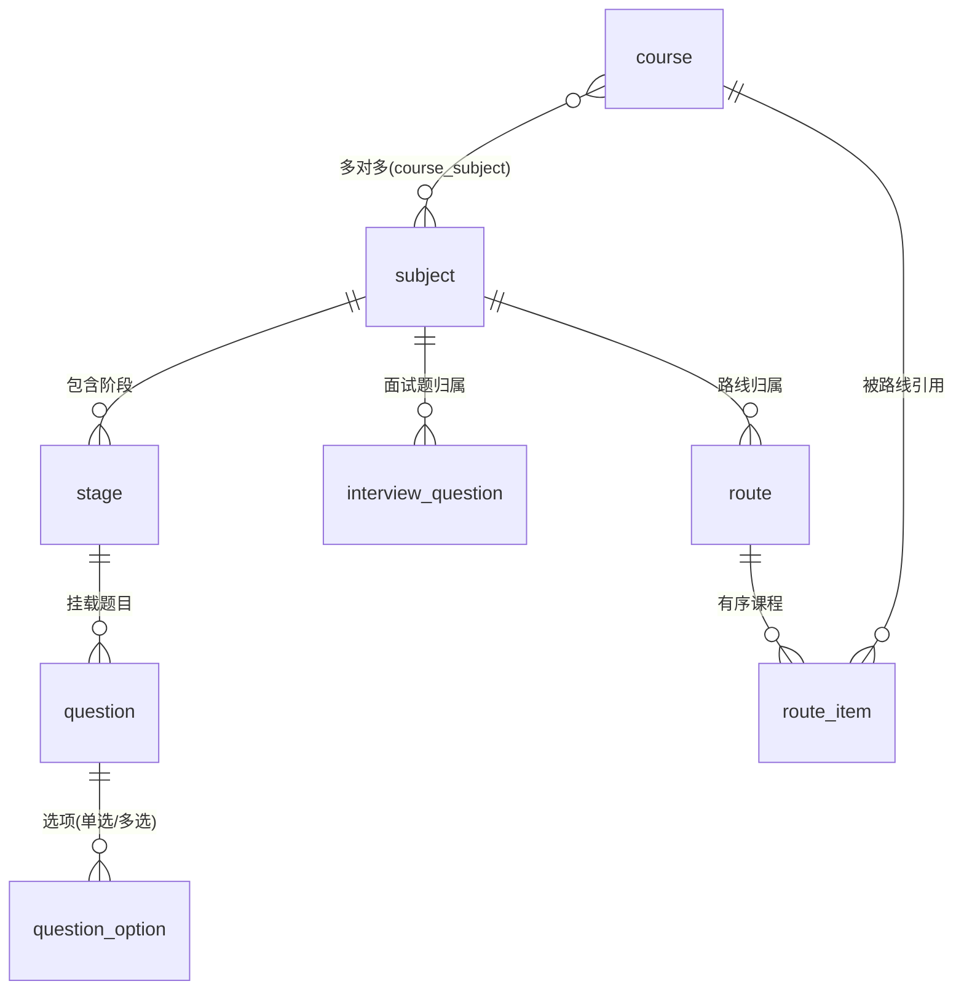
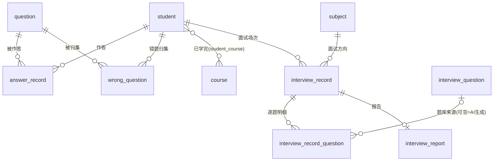
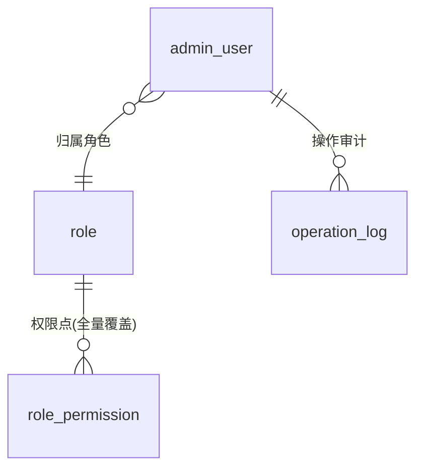

# 云枢智学 —— 数据库设计

> 阶段：设计第三阶段（数据库设计）
> 依据：`docs/design/01.功能模块梳理.md`、`docs/design/02.整体架构设计.md`（已定稿）、`docs/云枢智学-需求文档.md`、`prototype/`（原型数据口径）、`docs/rules/database-rules.md`（强制规范）
> 产物：本文 + `scripts/sql/schema.sql`（建表脚本）
> 范围：实体与表结构、字段/类型/约束/索引、逻辑关联与删除策略、需求覆盖与规范符合性检查。不含 API 接口定义（→ 04）与业务代码。
> **标记约定**：✅ = 已确认（01/02 定稿、本轮交互确认）；【决策】= 以规则/需求/原型为依据的设计选择，如有异议请在审核时指出；⚠️ = 待确认（见 §7）。

---

## 1. 设计总览

### 1.1 全局约定（依据 database-rules 与 02 决策）

| # | 约定 | 依据 |
|---|---|---|
| 1 | 表名/字段名 `snake_case`，表名**单数**风格统一（如 `student`、`course`），不使用保留字 | database-rules §2 |
| 2 | 主键统一 `id BIGINT AUTO_INCREMENT`；逻辑外键命名为 `<实体>_id` | database-rules §2.4、§4.1 |
| 3 | **禁止物理外键**（不建 FOREIGN KEY 约束），表间以逻辑关联字段衔接，引用完整性由应用层维护 | database-rules §4.2/4.3 |
| 4 | 时间统一 **UTC 存储**（`DATETIME`，连接时区设为 UTC，`CURRENT_TIMESTAMP` 即 UTC）；展示与「日界」计算在应用层按 **Asia/Shanghai** 转换 | database-rules §3.5、02 D9 |
| 5 | 通用审计字段：`created_at`（创建时间）、`updated_at`（更新时间）、`deleted_at`（逻辑删除时间，NULL=有效） | database-rules §2.5、需求 §6 逻辑删除 |
| 6 | 状态/枚举字段用 `TINYINT`，取值在 §4 状态字典中**逐一登记** | database-rules §3.6 |
| 7 | 多值字段（标签、作答快照、AI 评语、报告结构等）采用 **JSON 类型明确约定结构**（schema 见 §2.4/附录），不做逗号拼接 | database-rules §3.7 允许的「明确约定的结构化存储」 |
| 8 | 业务唯一值建**唯一约束**；在软删除表上通过「活动行唯一生成列」实现（见 §3.3） | database-rules §4.4 |
| 9 | 引擎 InnoDB，字符集 `utf8mb4`，排序规则 `utf8mb4_0900_ai_ci`；**库名 `yszx`** | 02 P3（MySQL 8）；库名 2026-11-23 用户确认 |
| 10 | 存储介质边界：验证码/频控/锁定/每日配额在 **Redis**（02 D12）；练习进度/面试会话/新手引导在**前端 localStorage**（02 D7）——均不落库 | 02 定稿 |
| 11 | 文件对象（头像/Logo 等）统一存 **MinIO 对象存储**（S3 兼容，02 D15），数据库仅存对象 URL（avatar_url/logo_url/default_avatar_url 等字段不变） | 02 D15（2026-11-23 变更） |

### 1.2 实体总览（21 张表）

| 分组 | 表 | 说明 |
|---|---|---|
| 账号 | `student` | 学员端账号（与后台账号体系独立，02 D3） |
| 账号 | `admin_user` | 管理端后台账号（内置超管唯一） |
| 权限 | `role`、`role_permission` | 角色与权限点（9 组 33 项，预置 3 角色） |
| 内容 | `subject`、`stage` | 学科（含「其他学科」）、阶段 |
| 内容 | `question`、`question_option` | 题库题目（挂阶段）与选项（单选/多选） |
| 内容 | `course`、`course_subject` | B站课程库与「课程—学科」多对多关联 |
| 内容 | `route`、`route_item` | 学习路线（单学科归属）与有序课程清单 |
| 学习 | `answer_record` | 答题记录（学习统计唯一数据源，追加型） |
| 学习 | `wrong_question` | 错题本（错误计数、纠正进度、掌握状态） |
| 学习 | `student_course` | 「标记已学完」记录（Q1 确认：按课程全局标记） |
| 面试 | `interview_question` | 面试题库（按学科归属，来源标记） |
| 面试 | `interview_record` | AI 面试场次记录（方向/难度/题量/得分/时长） |
| 面试 | `interview_record_question` | 逐题明细（题目/作答/评分快照） |
| 面试 | `interview_report` | 面试报告（1:1，六维能力/优缺点/建议） |
| 系统 | `operation_log` | 操作日志（管理端写操作+登录登出+导出） |
| 系统 | `system_setting` | 系统设置（单行：基本信息 + 首页好评率静态值） |

### 1.3 实体关系图（逻辑关联，无物理外键）

**内容体系：**



**学习与面试：**



**账号与系统：**



---

## 2. 表结构设计

> 字段表中「空」= 是否允许 NULL；时间字段单位均为 UTC。各表完整 DDL 见 `scripts/sql/schema.sql`。

### 2.1 账号与权限

#### 2.1.1 `student` 学员（学员端账号）

| 字段 | 类型 | 空 | 默认 | 说明 |
|---|---|---|---|---|
| id | BIGINT AUTO_INCREMENT | 否 | — | 主键 |
| phone | VARCHAR(11) | 否 | — | 手机号（登录凭证，业务唯一） |
| password_hash | VARCHAR(100) | 否 | — | 密码哈希（bcrypt） |
| nickname | VARCHAR(50) | 否 | — | 用户名/昵称（个人中心可编辑；学员管理以此搜索） |
| avatar_url | VARCHAR(255) | 是 | NULL | 头像 URL（未设置时用系统默认头像） |
| email | VARCHAR(100) | 是 | NULL | 邮箱（可编辑） |
| gender | TINYINT | 否 | 2 | 性别：0 男 / 1 女 / 2 保密 |
| status | TINYINT | 否 | 1 | 状态：1 已启用 / 0 已禁用 |
| last_login_at | DATETIME | 是 | NULL | 最后登录时间 |
| created_at | DATETIME | 否 | CURRENT_TIMESTAMP | 注册时间 |
| updated_at | DATETIME | 否 | CURRENT_TIMESTAMP ON UPDATE | — |
| deleted_at | DATETIME | 是 | NULL | 逻辑删除时间（NULL=有效） |
| phone_uk | VARCHAR(11) 生成列(VIRTUAL) | — | — | 活动行唯一键 = IF(deleted_at IS NULL, phone, NULL) |

- 索引：`UNIQUE uk_phone (phone_uk)`、`KEY idx_status (status)`、`KEY idx_created_at (created_at)`（看板用户增长趋势）。
- 【决策】手机号业务唯一（注册/登录凭证）；软删除后手机号可重新注册（生成列保证已删除行不占唯一性）。

#### 2.1.2 `admin_user` 后台用户

| 字段 | 类型 | 空 | 默认 | 说明 |
|---|---|---|---|---|
| id | BIGINT AUTO_INCREMENT | 否 | — | 主键 |
| username | VARCHAR(50) | 否 | — | 管理员账号（登录凭证，业务唯一） |
| password_hash | VARCHAR(100) | 否 | — | 密码哈希（bcrypt；重置为默认密码=应用层常量） |
| phone | VARCHAR(11) | 否 | — | 手机号（业务唯一） |
| email | VARCHAR(100) | 是 | NULL | 邮箱（选填） |
| avatar_url | VARCHAR(255) | 是 | NULL | 头像（用户详情展示） |
| role_id | BIGINT | 否 | — | 角色 id（逻辑关联 `role.id`；超管角色禁止授予新用户由应用层校验） |
| status | TINYINT | 否 | 1 | 1 已启用 / 0 已禁用 |
| last_login_at | DATETIME | 是 | NULL | 最后登录 |
| created_at / updated_at / deleted_at | 同上 | | | |
| username_uk / phone_uk | 生成列 | — | — | 活动行唯一键（同 2.1.1 模式） |

- 索引：`UNIQUE uk_username (username_uk)`、`UNIQUE uk_phone (phone_uk)`、`KEY idx_role_id (role_id)`。
- 【决策】`admin_user` 与 `student` 分表存储（02 D3，两端账号独立、Token 互不通用）。

#### 2.1.3 `role` 角色

| 字段 | 类型 | 空 | 默认 | 说明 |
|---|---|---|---|---|
| id | BIGINT AUTO_INCREMENT | 否 | — | 主键 |
| code | VARCHAR(50) | 否 | — | 角色编码（需求明确「必填、需唯一」；预置：super_admin / content_reviewer / operator） |
| name | VARCHAR(50) | 否 | — | 角色名称 |
| description | VARCHAR(255) | 是 | NULL | 角色描述 |
| is_preset | TINYINT | 否 | 0 | 1 预置角色（内置超管等，应用层保护不可删）/ 0 自建 |
| created_at / updated_at / deleted_at | 同上 | | | |
| code_uk | 生成列 | — | — | 活动行唯一键 |

- 索引：`UNIQUE uk_code (code_uk)`。
- 口径：超级管理员为内置唯一账号（01 A5），通过预置角色 + 应用层保护实现，不单设字段。

#### 2.1.4 `role_permission` 角色权限点

| 字段 | 类型 | 空 | 默认 | 说明 |
|---|---|---|---|---|
| id | BIGINT AUTO_INCREMENT | 否 | — | 主键 |
| role_id | BIGINT | 否 | — | 角色 id |
| permission_code | VARCHAR(50) | 否 | — | 权限码（9 组 33 项，目录为代码常量，见 04 附录 A 口径） |
| created_at | DATETIME | 否 | CURRENT_TIMESTAMP | — |

- 索引：`UNIQUE uk_role_perm (role_id, permission_code)`。
- 【决策】无 `deleted_at`：「编辑权限=保存为全量覆盖」（需求 4.5.2），事务内物理替换旧关联，属编辑语义而非删除语义（§3.2）。
- 【决策】不建权限目录表：33 个权限码是稳定常量，目录由 `core/rbac` 代码维护（02 D4），角色只存勾选结果。

#### 2.1.5 `system_setting` 系统设置（单行表，id=1）

| 字段 | 类型 | 空 | 默认 | 说明 |
|---|---|---|---|---|
| id | BIGINT AUTO_INCREMENT | 否 | 1 | 主键（固定单行 id=1，遵循统一自增主键策略） |
| platform_name | VARCHAR(50) | 否 | 云枢智学 | 平台名称（保存时非空校验） |
| platform_description | VARCHAR(500) | 是 | NULL | 平台描述 |
| logo_url | VARCHAR(255) | 是 | NULL | Logo URL |
| default_avatar_url | VARCHAR(255) | 是 | NULL | 默认头像 URL |
| good_rate | DECIMAL(5,2) | 否 | 98.00 | 首页「好评率」静态展示值（%）——Q2 确认：无对应业务功能，静态维护，不在设置页 UI 暴露 |
| created_at / updated_at | 同上 | | | |

- 【决策】Q2 确认首页 Hero 口径：精选面试题=题库已上架题目数、注册学员=学员总数、AI面试次数=面试记录数（三项实时统计），好评率取本字段。

#### 2.1.6 `operation_log` 操作日志

| 字段 | 类型 | 空 | 默认 | 说明 |
|---|---|---|---|---|
| id | BIGINT AUTO_INCREMENT | 否 | — | 主键 |
| admin_user_id | BIGINT | 是 | NULL | 操作人 id（登录失败等无主场景为空） |
| admin_username | VARCHAR(50) | 是 | NULL | 操作人账号快照（防用户改名后失真） |
| action_type | TINYINT | 否 | — | 操作类型分类（映射筛选项，见 §4） |
| action_desc | VARCHAR(200) | 否 | — | 操作描述（如「新增课程」「审核通过题目」） |
| target | VARCHAR(200) | 是 | NULL | 操作对象（如「课程《xxx》」） |
| detail | VARCHAR(500) | 是 | NULL | 详情（看板「最近活动」列） |
| ip | VARCHAR(45) | 否 | — | IP 地址（兼容 IPv6） |
| created_at | DATETIME | 否 | CURRENT_TIMESTAMP | 操作时间 |
| deleted_at | DATETIME | 是 | NULL | 「清空日志」= 批量逻辑删除（§3.2） |

- 索引：`KEY idx_created (created_at)`、`KEY idx_user (admin_user_id)`、`KEY idx_type_time (action_type, created_at)`。
- 记录范围（B5 ✅）：管理端全部写操作 + 登录/登出 + 导出；由 `core/audit` 统一埋点（02 D13）。

### 2.2 内容体系

#### 2.2.1 `subject` 学科

| 字段 | 类型 | 空 | 默认 | 说明 |
|---|---|---|---|---|
| id | BIGINT AUTO_INCREMENT | 否 | — | 主键 |
| name | VARCHAR(50) | 否 | — | 学科名称（业务唯一；含「其他学科」兜底学科） |
| icon | VARCHAR(10) | 否 | — | 学科图标（Emoji） |
| description | VARCHAR(255) | 否 | — | 学科描述 |
| sort_order | INT | 否 | 0 | 排序号（越小越靠前） |
| theme_color | VARCHAR(20) | 否 | — | 主题颜色（预置色板取值） |
| created_at / updated_at / deleted_at | 同上 | | | |
| name_uk | 生成列 | — | — | 活动行唯一键 |

- 索引：`UNIQUE uk_name (name_uk)`、`KEY idx_sort (sort_order)`。

#### 2.2.2 `stage` 阶段

| 字段 | 类型 | 空 | 默认 | 说明 |
|---|---|---|---|---|
| id | BIGINT AUTO_INCREMENT | 否 | — | 主键 |
| subject_id | BIGINT | 否 | — | 所属学科 id |
| name | VARCHAR(50) | 否 | — | 阶段名称 |
| icon | VARCHAR(10) | 是 | NULL | 阶段图标（留空默认） |
| sort_order | INT | 否 | 0 | 排序号 |
| status | TINYINT | 否 | 1 | 1 启用 / 0 禁用 |
| created_at / updated_at / deleted_at | 同上 | | | |

- 索引：`KEY idx_subject_sort (subject_id, sort_order)`。
- 阶段是题目的挂载层级、首页「热门阶段」来源（01 §4.1）。

#### 2.2.3 `question` 题目

| 字段 | 类型 | 空 | 默认 | 说明 |
|---|---|---|---|---|
| id | BIGINT AUTO_INCREMENT | 否 | — | 主键 |
| stage_id | BIGINT | 否 | — | 所属阶段 id（题目挂阶段下） |
| type | TINYINT | 否 | — | 题型：1 单选 / 2 多选 / 3 判断 / 4 简答 |
| difficulty | TINYINT | 否 | — | 难度：1 简单 / 2 中等 / 3 困难 |
| status | TINYINT | 否 | 3 | 状态：1 已上架 / 2 已下架 / 3 待审核 / 4 草稿（DB 预留，不启用）/ 5 已驳回；新增默认直入「待审核」 |
| content | TEXT | 否 | — | 题干 |
| judge_answer | TINYINT | 是 | NULL | 判断题正确答案：1 正确 / 0 错误（仅 type=3） |
| reference_answer | TEXT | 是 | NULL | 简答题参考答案（仅 type=4，可留空） |
| analysis | TEXT | 是 | NULL | 解析 |
| tags | JSON | 是 | NULL | 标签数组，如 `["RAG","检索"]`（结构化存储，不逗号拼接） |
| created_by | BIGINT | 是 | NULL | 创建人（admin_user.id，审计用） |
| created_at / updated_at / deleted_at | 同上 | | | |

- 索引：`KEY idx_stage_status (stage_id, status)`、`KEY idx_type_difficulty (type, difficulty)`。
- 【决策】题目**状态枚举含草稿（4）为 DB 预留值**（01 §2.3/4.2 已确认「当前不启用」）；状态流转（新增→待审核→已上架/已驳回→…）由应用层实现，审核人等过程信息不在表中留存（审计走 `operation_log`）。
- 【决策】题目详情/题卡的「答题次数、正确次数、正确率、N 人做过」均由 `answer_record` 聚合（口径见 §5.2），不在本表冗余计数器。

#### 2.2.4 `question_option` 题目选项（单选/多选）

| 字段 | 类型 | 空 | 默认 | 说明 |
|---|---|---|---|---|
| id | BIGINT AUTO_INCREMENT | 否 | — | 主键 |
| question_id | BIGINT | 否 | — | 所属题目 id |
| option_key | CHAR(1) | 否 | — | 选项键 A–F |
| content | VARCHAR(500) | 否 | — | 选项内容 |
| is_correct | TINYINT | 否 | 0 | 1 正确答案 / 0 非正确（多选可多个 1） |
| sort_order | INT | 否 | 0 | 展示顺序 |
| created_at | DATETIME | 否 | CURRENT_TIMESTAMP | — |

- 索引：`UNIQUE uk_question_key (question_id, option_key)`。
- 【决策】无 `deleted_at`：选项随题目「选项管理（增删 2~6 项）」**编辑整体替换**（§3.2）；判分所需的正确答案快照已存入 `answer_record`，历史作答不受选项调整影响。判断题不建选项行（用 `question.judge_answer`），简答无选项。

#### 2.2.5 `course` 课程（B站课程库）

| 字段 | 类型 | 空 | 默认 | 说明 |
|---|---|---|---|---|
| id | BIGINT AUTO_INCREMENT | 否 | — | 主键 |
| name | VARCHAR(200) | 否 | — | 课程名称 |
| bvid | VARCHAR(20) | 是 | NULL | BV 号（选填、业务唯一；导入「覆盖更新」的匹配键之一） |
| cover_url | VARCHAR(255) | 是 | NULL | 封面图片 URL |
| duration_minutes | INT | 否 | — | 时长（分钟，规范计量；表单「小时:分钟」、导入「分钟」均归一到分钟） |
| source | TINYINT | 否 | 1 | 来源：1 B站 / 2 其他 |
| play_url | VARCHAR(255) | 是 | NULL | 播放链接（「去B站学习」跳转） |
| sort_seq | BIGINT | 否 | 0 | 列表顺序权重（导入按 Excel 行序、非导入按最新在前，见 §5.2 口径） |
| created_at / updated_at / deleted_at | 同上 | | | |
| bvid_uk | 生成列 | — | — | 活动行唯一键（bvid 为 NULL 的行不参与唯一校验） |

- 索引：`UNIQUE uk_bvid (bvid_uk)`、`KEY idx_sort_seq (sort_seq)`。
- 【决策】课程库**无上架/下架状态字段**（01 阶段 8 同步：与需求 4.3.2 一致）。
- 【决策】「无 BV 号时按 课程名称+来源 匹配（覆盖更新）」为导入逻辑（应用层），不加唯一约束（需求未要求名称唯一）。

#### 2.2.6 `course_subject` 课程—学科关联（多对多）

| 字段 | 类型 | 空 | 默认 | 说明 |
|---|---|---|---|---|
| id | BIGINT AUTO_INCREMENT | 否 | — | 主键 |
| course_id | BIGINT | 否 | — | 课程 id |
| subject_id | BIGINT | 否 | — | 学科 id |
| is_primary | TINYINT | 否 | 0 | 1 主学科（表单选择顺序第一个）/ 0 关联学科 |
| created_at | DATETIME | 否 | CURRENT_TIMESTAMP | — |

- 索引：`UNIQUE uk_course_subject (course_id, subject_id)`、`KEY idx_subject (subject_id)`。
- 【决策】无 `deleted_at`：课程编辑/导入的「关联学科整体替换」（需求 4.3.2 导入语义）为**编辑替换**（§3.2）。「其他学科」即普通学科行，靠应用层约束其排他单选。

#### 2.2.7 `route` 学习路线

| 字段 | 类型 | 空 | 默认 | 说明 |
|---|---|---|---|---|
| id | BIGINT AUTO_INCREMENT | 否 | — | 主键 |
| subject_id | BIGINT | 否 | — | 归属学科 id（B3 ✅ 单学科归属） |
| name | VARCHAR(100) | 否 | — | 路线名称 |
| icon | VARCHAR(10) | 是 | NULL | 路线图标 |
| target_education | VARCHAR(50) | 是 | NULL | 适合学历 |
| description | VARCHAR(500) | 是 | NULL | 路线描述 |
| status | TINYINT | 否 | 1 | 1 启用 / 0 禁用（发布/下线） |
| created_at / updated_at / deleted_at | 同上 | | | |

- 索引：`KEY idx_subject_status (subject_id, status)`。
- 一学科可多条路线（D4-24）；学员端只展示启用路线。

#### 2.2.8 `route_item` 路线课程（有序）

| 字段 | 类型 | 空 | 默认 | 说明 |
|---|---|---|---|---|
| id | BIGINT AUTO_INCREMENT | 否 | — | 主键 |
| route_id | BIGINT | 否 | — | 路线 id |
| course_id | BIGINT | 否 | — | 课程 id（可跨学科补充，B3） |
| sort_order | INT | 否 | 0 | 课程顺序（=学习顺序） |
| created_at | DATETIME | 否 | CURRENT_TIMESTAMP | — |

- 索引：`UNIQUE uk_route_course (route_id, course_id)`、`KEY idx_route_sort (route_id, sort_order)`。
- 【决策】无 `deleted_at`：添加/移除/排序为**编辑替换**（§3.2）。

### 2.3 学习训练

#### 2.3.1 `answer_record` 答题记录（追加型）

| 字段 | 类型 | 空 | 默认 | 说明 |
|---|---|---|---|---|
| id | BIGINT AUTO_INCREMENT | 否 | — | 主键 |
| student_id | BIGINT | 否 | — | 学员 id |
| question_id | BIGINT | 否 | — | 题目 id |
| scene | TINYINT | 否 | — | 场景：1 刷题练习 / 2 错题重做（Q3 确认：仅场景 2 计入错题纠正进度） |
| answer | JSON | 是 | NULL | 作答快照（单选/多选=选项键数组；判断=bool；简答=文本，见附录 A） |
| is_correct | TINYINT | 否 | — | 1 正确 / 0 错误（简答按 AI 评分 ≥6 判通过，02 D10 阈值） |
| ai_grade | JSON | 是 | NULL | 简答 AI 批改结果 `{score, comment, key_points}`（客观题为 NULL） |
| created_at | DATETIME | 否 | CURRENT_TIMESTAMP | 答题时间 |

- 索引：`KEY idx_student_time (student_id, created_at)`、`KEY idx_question (question_id)`、`KEY idx_student_question (student_id, question_id)`。
- 【决策】追加型、无 `deleted_at`/`updated_at`（无删除入口；练习中途状态在前端 localStorage，仅**判分完成的作答**落库）。
- 本表是全部学习统计的唯一数据源（口径见 §5.2）。

#### 2.3.2 `wrong_question` 错题本

| 字段 | 类型 | 空 | 默认 | 说明 |
|---|---|---|---|---|
| id | BIGINT AUTO_INCREMENT | 否 | — | 主键 |
| student_id | BIGINT | 否 | — | 学员 id |
| question_id | BIGINT | 否 | — | 题目 id |
| wrong_count | INT | 否 | 1 | 错误次数（错题等级的唯一依据：≥3 高频易错 / =2 多次 / =1 偶尔，等级为派生值不落库） |
| correct_streak | INT | 否 | 0 | 连续纠正次数（0~3，**仅错题重做场景**累加/清零，Q3 ✅） |
| mastery_status | TINYINT | 否 | 0 | 0 待复习 / 1 已掌握（连续答对 3 次自动或手动标记） |
| last_wrong_answer | JSON | 是 | NULL | 「你的答案」快照（最近一次答错，格式同 answer_record.answer） |
| last_wrong_at | DATETIME | 否 | — | 最近答错时间（列表默认排序键） |
| mastered_at | DATETIME | 是 | NULL | 标记已掌握时间 |
| created_at / updated_at / deleted_at | 同上 | | | |
| pair_uk | VARCHAR(64) 生成列 | — | — | 活动行唯一键 = IF(deleted_at IS NULL, CONCAT(student_id,'-',question_id), NULL) |

- 索引：`UNIQUE uk_pair (pair_uk)`、`KEY idx_student_mastery (student_id, mastery_status)`、`KEY idx_student_lastwrong (student_id, last_wrong_at)`。
- 计数更新规则（Q3 ✅）：
  - 任意场景答错：`wrong_count`+1、更新 `last_wrong_answer/last_wrong_at`；掌握状态**不回退**（S10 ✅）；`correct_streak` 仅在重做场景清零；
  - 重做场景答对：`correct_streak`+1，达 3 → `mastery_status`=1、记 `mastered_at`；
  - 重做场景答错：`correct_streak`=0；
  - 普通练习场景答对：不影响本表。
- 「移除错题」= 逻辑删除（`deleted_at`）；再答错同一题时应用层复活该行（计数续增）或新建行由唯一约束兜底。

#### 2.3.3 `student_course` 已学课程（追加型）

| 字段 | 类型 | 空 | 默认 | 说明 |
|---|---|---|---|---|
| id | BIGINT AUTO_INCREMENT | 否 | — | 主键 |
| student_id | BIGINT | 否 | — | 学员 id |
| course_id | BIGINT | 否 | — | 课程 id（Q1 ✅ 按课程全局标记，不区分路线） |
| created_at | DATETIME | 否 | CURRENT_TIMESTAMP | 标记时间 |

- 索引：`UNIQUE uk_student_course (student_id, course_id)`、`KEY idx_course (course_id)`。
- 【决策】追加型：需求 3.7「仅可标记、不可取消」→ 无删除语义，不设 `deleted_at`。
- 路线进度 N/M = 该路线 `route_item` 中被标记的课程数 / 课程总数；学员详情「已学课程」= 本表关联 `course`。

### 2.4 AI 面试

#### 2.4.1 `interview_question` 面试题库

| 字段 | 类型 | 空 | 默认 | 说明 |
|---|---|---|---|---|
| id | BIGINT AUTO_INCREMENT | 否 | — | 主键 |
| subject_id | BIGINT | 否 | — | 归属学科 id（A2/A3 ✅ 方向=学科） |
| content | TEXT | 否 | — | 题干 |
| difficulty | TINYINT | 否 | — | 1 简单 / 2 中等 / 3 困难 |
| topic | VARCHAR(100) | 是 | NULL | 主题（**自由文本**，D4-20；NULL=未分类，筛选为模糊匹配） |
| tags | JSON | 是 | NULL | 标签数组（结构化存储） |
| reference_answer | TEXT | 是 | NULL | 参考答案（可留空） |
| source_type | TINYINT | 否 | — | 来源：1 手工录入 / 2 Excel 导入（A2 ✅ 无知识库实体） |
| source_file | VARCHAR(255) | 是 | NULL | 来源文件名（Excel 导入时记录，纯文本） |
| source_row | INT | 是 | NULL | 来源数据行序号 |
| status | TINYINT | 否 | 1 | 1 已上架（默认，当前**无上架/下架入口**，阶段 11 修正） |
| created_at / updated_at / deleted_at | 同上 | | | |

- 索引：`KEY idx_subject_difficulty (subject_id, difficulty)`（AI 抽题）、`KEY idx_topic (topic)`。
- 【决策】删除为逻辑删除，删除提示按来源区分风险（手工录入不可恢复提示）由应用层文案实现；「检索测试/主题词表维护」不实现（D4-21），无词表关联表。

#### 2.4.2 `interview_record` 面试记录（场次）

| 字段 | 类型 | 空 | 默认 | 说明 |
|---|---|---|---|---|
| id | BIGINT AUTO_INCREMENT | 否 | — | 主键 |
| student_id | BIGINT | 否 | — | 学员 id |
| subject_id | BIGINT | 否 | — | 面试方向（=学科） |
| difficulty | TINYINT | 否 | — | 面试难度 |
| question_count | INT | 否 | — | 配置题量（3/5/8/10/15） |
| answered_count | INT | 否 | 0 | 实际作答题数（中途结束 < 配置题量） |
| overall_score | DECIMAL(5,1) | 是 | NULL | 综合评分 0~100（原型量纲；报告生成时写入） |
| duration_seconds | INT | 否 | 0 | 面试时长（秒） |
| started_at | DATETIME | 是 | NULL | 开始时间 |
| finished_at | DATETIME | 是 | NULL | 结束/生成报告时间 |
| created_at / updated_at | DATETIME | 否 | — | — |

- 索引：`KEY idx_student_subject_time (student_id, subject_id, finished_at)`（「相比上次」取同方向上一场）、`KEY idx_student_time (student_id, finished_at)`。
- 【决策】无 `deleted_at`（面试记录无删除入口）；每日 5 次配额的计数在 Redis（02 D12），本表可作对账来源。

#### 2.4.3 `interview_record_question` 面试逐题明细（追加型）

| 字段 | 类型 | 空 | 默认 | 说明 |
|---|---|---|---|---|
| id | BIGINT AUTO_INCREMENT | 否 | — | 主键 |
| interview_record_id | BIGINT | 否 | — | 场次 id |
| seq | INT | 否 | — | 题号（1..N） |
| interview_question_id | BIGINT | 是 | NULL | 来源题库 id（Q4 ✅ 可空：AI 补充生成题无库内来源） |
| question_text | TEXT | 否 | — | 题干**快照**（题库题目后续变更/删除不影响报告） |
| reference_answer | TEXT | 是 | NULL | 参考答案快照 |
| user_answer | TEXT | 是 | NULL | 学员作答（文本；超时未答为 NULL） |
| timed_out | TINYINT | 否 | 0 | 1 超时（单问固定 5 分钟）/ 0 正常 |
| score | DECIMAL(4,1) | 是 | NULL | 逐题评分 0~10（配色：≥8 绿 / ≥6 橙 / <6 红） |
| ai_comment | VARCHAR(1000) | 是 | NULL | AI 评语 |
| created_at | DATETIME | 否 | CURRENT_TIMESTAMP | — |

- 索引：`KEY idx_record_seq (interview_record_id, seq)`。
- 【决策】追加型快照表——Q4「题库优先抽取 + AI 补充」要求快照与引用并存：引用用于溯源，快照用于报告展示。

#### 2.4.4 `interview_report` 面试报告（1:1）

| 字段 | 类型 | 空 | 默认 | 说明 |
|---|---|---|---|---|
| id | BIGINT AUTO_INCREMENT | 否 | — | 主键 |
| interview_record_id | BIGINT | 否 | — | 场次 id（业务唯一） |
| overall_comment | TEXT | 是 | NULL | 整体评价 |
| accuracy_rate | DECIMAL(5,2) | 是 | NULL | 回答准确度（%） |
| ability_scores | JSON | 否 | — | 六维能力分数（键固定：专业基础/表达沟通/逻辑思维/项目经验/应变能力/岗位匹配，原型定稿） |
| strengths | JSON | 是 | NULL | 优点列表（字符串数组） |
| improvements | JSON | 是 | NULL | 待提升列表 `[{issue, advice}]`（问题描述+指导建议） |
| suggestions | JSON | 是 | NULL | 改进建议（字符串数组，展示时编号） |
| coaching | JSON | 是 | NULL | 能力提升建议三卡 `{questions, courses, reinterview}`（指导性文案，B6 无下载/分享） |
| created_at / updated_at | DATETIME | 否 | — | — |

- 索引：`UNIQUE uk_record (interview_record_id)`。
- 【决策】报告叙述性内容整体采用 JSON 结构化存储（附录 A）；可检索的量值（评分/时长/题量）在 `interview_record` 列上，满足记录列表、统计卡（总次数/平均分/最高分/累计时长）与「相比上次」查询。

---

## 3. 逻辑关联与删除策略

### 3.1 逻辑关联清单（无物理外键，应用层保证完整性）

| 引用方.字段 | → 目标 | 关系 | 完整性维护（应用层） |
|---|---|---|---|
| stage.subject_id | subject | N:1 | 删除学科提示子级数量（需求 4.3.1） |
| question.stage_id | stage | N:1 | 删除阶段提示关联题目数 |
| question_option.question_id | question | N:1 | 选项随题目编辑替换 |
| course_subject.course_id / subject_id | course / subject | N:M | 编辑/导入整体替换；「其他学科」排他 |
| route.subject_id | subject | N:1 | — |
| route_item.route_id / course_id | route / course | N:M | 有序；移除/排序为编辑替换 |
| answer_record.student_id / question_id | student / question | N:1 | 题目删除后记录保留（统计不失真） |
| wrong_question.student_id / question_id | student / question | N:1 | 同上 |
| student_course.student_id / course_id | student / course | N:M | 仅标记不取消 |
| interview_question.subject_id | subject | N:1 | — |
| interview_record.student_id / subject_id | student / subject | N:1 | — |
| interview_record_question.interview_record_id / interview_question_id | interview_record / interview_question | N:1 | 题目引用**可空**；题干以快照为准 |
| interview_report.interview_record_id | interview_record | 1:1 | 结束面试时生成 |
| admin_user.role_id | role | N:1 | 角色下有用户禁止删除（需求 4.5.2） |
| role_permission.role_id | role | N:1 | 全量覆盖 |
| operation_log.admin_user_id | admin_user | N:1 | 允许 NULL；账号删后日志保留（含快照名） |

### 3.2 删除策略

| 策略 | 适用表 | 说明 |
|---|---|---|
| **逻辑删除**（写 `deleted_at`，查询过滤 `deleted_at IS NULL`） | student、admin_user、role、subject、stage、question、course、route、interview_question、wrong_question、operation_log | 覆盖需求 §6「均逻辑删除、可恢复」的全部用户删除入口（删除/批量删除/移除错题/清空日志） |
| **编辑替换**（事务内物理替换行，属编辑语义） | question_option、course_subject、route_item、role_permission | 对应「选项增删」「关联学科整体替换」「路线课程移除/排序」「权限全量覆盖」；被替换行不留存（题目/课程等主实体的历史由 `answer_record`/`interview_record_question` 快照保障） |
| **追加只增**（无删除语义） | answer_record、student_course、interview_record_question | 统计与快照数据；「标记已学完」不可取消（需求 3.7） |
| **无删除入口** | interview_record、interview_report、system_setting | 保留历史报告；系统设置单行 |

- **级联口径 ⚠️（§7 S1 待确认）**：建议「**父删子不级联**」——删除学科/阶段等父实体只标记父行，子数据（阶段/题目/选项）保留且随父级在查询中过滤隐藏；恢复父行即恢复可见性。理由：贴合「软删除可恢复」语义，避免级联恢复的复杂性。
- **恢复语义**：逻辑删除行可通过清空 `deleted_at` 恢复；业务唯一由生成列自动重新参与校验。

### 3.3 唯一性与软删除的兼容约定（重要）

MySQL 唯一索引中 NULL 互不相等：若直接对业务列建唯一索引，已删除行会**永久占用**业务值；若建 `(业务列, deleted_at)` 复合唯一，又**拦不住**两条有效行（两边 NULL 视为不等）。因此统一采用**活动行唯一生成列**：

```sql
-- 以 student.phone 为例（VIRTUAL 生成列，不占存储，可建唯一索引）
phone_uk  VARCHAR(11)  GENERATED ALWAYS AS (IF(deleted_at IS NULL, phone, NULL)) VIRTUAL,
UNIQUE KEY uk_phone (phone_uk)
```

- 有效行：生成列=业务值 → 唯一约束生效；已删除行：生成列=NULL → 多行豁免。
- 适用：`student.phone`、`admin_user.username/phone`、`role.code`、`subject.name`、`course.bvid`、`wrong_question(student_id,question_id)`（CONCAT 拼键）。
- 无软删除的表（§3.2 编辑替换/追加型）直接用普通唯一索引。

---

## 4. 枚举与状态字典

> 满足 database-rules §3.6「状态字段取值有限且有文档说明」；SQL COMMENT 同步登记。

| 枚举 | 取值 | 用于字段 |
|---|---|---|
| 性别 | 0 男 / 1 女 / 2 保密（默认 2） | student.gender |
| 启用状态 | 1 已启用 / 0 已禁用 | student.status、admin_user.status |
| 启停状态 | 1 启用 / 0 禁用 | stage.status、route.status |
| 题型 | 1 单选 / 2 多选 / 3 判断 / 4 简答 | question.type |
| 难度 | 1 简单 / 2 中等 / 3 困难 | question.difficulty、interview_question.difficulty、interview_record.difficulty |
| 题目状态 | 1 已上架 / 2 已下架 / 3 待审核（默认）/ 4 草稿（预留不启用）/ 5 已驳回 | question.status |
| 判断答案 | 1 正确 / 0 错误 | question.judge_answer |
| 正确标记 | 1 是 / 0 否 | question_option.is_correct、answer_record.is_correct、course_subject.is_primary、role_permission（无）、interview_record_question.timed_out |
| 课程来源 | 1 B站 / 2 其他 | course.source |
| 面试题来源 | 1 手工录入 / 2 Excel 导入 | interview_question.source_type |
| 面试题状态 | 1 已上架（默认，当前无出入口） | interview_question.status |
| 作答场景 | 1 刷题练习 / 2 错题重做 | answer_record.scene |
| 错题掌握 | 0 待复习 / 1 已掌握 | wrong_question.mastery_status |
| 操作类型 | 1 登录类（登录/登出）/ 2 新增·创建·上传（含导入）/ 3 修改·编辑（含审核、上下架、排序、授权、重置密码、保存设置）/ 4 删除（含批量删除、清空日志）/ 5 禁用·启用（含批量）/ 6 其他（含导出） | operation_log.action_type |
| 预置标记 | 1 预置 / 0 自建 | role.is_preset |

> 说明：`question.status=4 草稿` 为 01 已确认的 DB 预留值（当前流程不产生草稿）；`operation_type` 映射对齐需求 4.5.3 筛选项（「全部/登录/新增·创建·上传/修改·编辑/删除/禁用·启用/其他」），登出与登录同归 1 类（口径见 §7 S9）。

---

## 5. 业务需求覆盖检查

### 5.1 功能覆盖对照（节选关键项，逐模块核对）

| 需求功能点 | 支撑设计 |
|---|---|
| 注册/登录/找回密码 | student（phone 唯一）+ Redis 验证码/锁定（02 D12）；第三方登录仅占位（D18），无表 |
| 个人中心（资料/头像/学习数据） | student 字段 + answer_record/interview_record 聚合 |
| 首页（平台数据/学习统计/7日趋势/热门阶段） | §5.2 统计口径；system_setting.good_rate；stage+question 计数 |
| 题库中心（三级浏览/筛选/题卡统计） | subject→stage→question(+option)；「N 人做过/正确率」聚合 answer_record |
| 刷题练习（判分/简答 AI 批改/本地进度） | answer_record（判分落库）+ ai_grade JSON；进度 localStorage（不落库） |
| 错题本（统计卡/Top3/分级/重做/掌握） | wrong_question（wrong_count 派生等级、correct_streak、mastery_status）+ answer_record(scene=2) |
| 学习路线（路线 Tab/进度/标记已学完） | route+route_item+student_course（Q1 全局标记） |
| AI 面试配置（配额/方向/难度/题量） | interview_record + Redis 配额计数 |
| AI 面试进行中（对话/评分/超时/会话续做） | interview_record_question 逐题快照；会话 localStorage |
| 面试报告（总分/六维/优缺点/建议/补强） | interview_report JSON + interview_record 量值 |
| 面试记录（统计卡/列表/再来一次） | interview_record 聚合（总次数/平均/最高/累计时长） |
| 数据看板（4 卡/增长/分布/最近活动/快捷操作） | subject/question/student/interview_record 计数；student.created_at 趋势；question→stage→subject 分布；operation_log |
| 学科管理（卡片统计/删除三态提示） | subject+stage+question 计数（按有效行过滤） |
| B站课程库（统计卡/筛选/批量导入/覆盖更新） | course+course_subject；bvid 唯一；sort_seq 列表顺序 |
| 题库管理（状态流转/审核/批量/导入导出） | question.status 枚举流转；导入导出 14 列与表字段映射 |
| 面试题库管理（来源/主题模糊/只看未分类） | interview_question（source_*、topic NULL=未分类） |
| 学习路线管理（编排/排序/从课程库添加/预览） | route+route_item |
| 学员管理（详情/学习天数/正确率/已学课程/导出） | §5.2 口径（Asia/Shanghai 日界已确认） |
| 用户/角色管理（9 组 33 项/预置 3 角色/内置超管） | admin_user+role+role_permission；权限码常量目录 |
| 操作日志（筛选/详情/导出 CSV/清空） | operation_log（action_type 映射筛选；清空=批量逻辑删除） |
| 系统设置（仅基本信息） | system_setting（+good_rate 静态值，Q2 ✅） |
| 安全与频控（T6 已定稿） | Redis（无表）：锁定/验证码频控/接口限流 |

### 5.2 统计口径定义（04/开发阶段一致引用）

| 指标 | 口径 |
|---|---|
| 学习天数 | `COUNT(DISTINCT DATE(CONVERT_TZ(answer_record.created_at,'+00:00','+08:00')))`（01：累计有作答的去重天数，Asia/Shanghai 日界） |
| 连续学习天数（streak） | 截至今天（今天无作答则截至昨天）向前连续有作答的天数，中断即为 0（评审 W2 ✅） |
| 正确率 | 答对数 ÷ 作答总数（无作答记 0），源 answer_record |
| 总练习数 / 做题数 / 今日已刷 / 近 7 天趋势 | 均为**作答题次**（题次口径，原型 `totalPracticed` 与「做题数」同值佐证）；按 created_at（转 +08:00）按日聚合 |
| 题卡「N 人做过」 | `COUNT(DISTINCT student_id)`，限该题有效作答记录 |
| 题目详情「答题/正确次数」 | `COUNT(*)` / `SUM(is_correct)`，源 answer_record |
| 错题等级 | 派生：wrong_count ≥3 高频易错 / =2 多次错误 / =1 偶尔错误（不落库） |
| 错题统计卡 | 总数=有效错题行；待复习= mastery_status=0；已掌握=1；掌握率=已掌握÷总数 |
| 高频错题 Top3 | 待复习中按 wrong_count 倒序取 3（并列按 last_wrong_at 倒序） |
| 路线进度 N/M | 路线 route_item 中 course_id ∈ student_course 的条数 / route_item 条数 |
| 面试「相比上次」 | 同 student+subject 最近一场 overall_score 与本场差值（提升/下降/持平） |
| 面试报告评分 | `overallScore`（综合评分 0-100）= 逐题平均分 ×10（保留 1 位小数）；`accuracyRate`（回答准确度 %）= 得分 ≥6 分题数 ÷ 已答题数 ×100（评审 W3 ✅） |
| 看板用户增长 | student 按日注册计数（7/30/90 天，Asia/Shanghai 日界），idx_created_at |
| 看板/首页平台数 | 学科数=subject 有效行；题目数=question 有效行（首页=已上架）；注册学员=student 有效行；AI面试次数=interview_record 行数；好评率=system_setting.good_rate |
| 精选面试题（首页） | **题库已上架题目数**（Q2 ✅） |

---

## 6. 规范符合性检查（对照 docs/rules/database-rules.md）

| 规则条款 | 落实 |
|---|---|
| §2.1 snake_case | 全部表/字段 ✓ |
| §2.2 语义明确、无拼音缩写 | ✓（如 duration_minutes、correct_streak） |
| §2.3 单复数统一 | 统一单数（student、course…）✓ |
| §2.4 主键 id、外键 <实体>_id | ✓ |
| §2.5 时间语义明确 | created_at/updated_at/deleted_at/last_wrong_at/mastered_at/started_at/finished_at ✓ |
| §2.6 避免保留字 | 已核对（type/status/source 等均为非保留字）✓ |
| §2.7 命名一致 | ✓ |
| §3.1 类型准确 | TINYINT 枚举 / INT 计数 / DECIMAL 评分 / DATETIME / JSON / TEXT 长文本 ✓ |
| §3.2 必填 NOT NULL | 必填字段均 NOT NULL，可空均有业务含义 ✓ |
| §3.3 默认值有意义 | 如 question.status 默认 3（直入待审核）、mastery_status 默认 0 ✓ |
| §3.4 定点数 | 评分/比率用 DECIMAL，无浮点 ✓ |
| §3.5 时区 | UTC 存储 + Asia/Shanghai 展示/日界（推荐策略），已在 §1.1 记录 ✓ |
| §3.6 状态取值有限有文档 | §4 状态字典 + SQL COMMENT ✓ |
| §3.7 禁多值拼接 | 多值一律 JSON 明确约定结构（附录 A），无逗号拼接字段 ✓ |
| §4.1 自增主键 | 全部表 id AUTO_INCREMENT ✓ |
| §4.2/4.3 禁物理外键、逻辑关联 | 无任何 FOREIGN KEY；§3.1 清单 + 应用层校验 ✓ |
| §4.4 业务唯一用唯一约束 | §3.3 生成列方案 ✓（phone/bvid/role.code/…） |
| §4.5 服务端校验+数据库约束防线 | 由 04 接口校验 + 本设计约束共同保障 ✓ |

---

## 7. 决策记录、口径说明与待确认问题

### 7.1 本轮交互确认（✅ 已定案）

| # | 问题 | 结论 | 影响 |
|---|---|---|---|
| Q1 | 「标记已学完」粒度 | ✅ **按课程全局标记**（一次标记，各路线进度同步生效） | student_course 主键 (student_id, course_id)，无 route_id |
| Q2 | 首页 Hero 数据来源 | ✅ **三项实时统计 + 好评率静态**：精选面试题=题库已上架题目数、注册学员=学员数、AI面试次数=面试记录数；好评率=system_setting.good_rate 静态值 | system_setting 增加 good_rate 字段 |
| Q3 | 错题纠正计数范围 | ✅ **仅错题重做场景计数**：重做答对 +1（达 3 自动掌握）、重做答错清零；普通练习答错只累计错误次数与快照，不影响纠正进度 | answer_record.scene 字段；wrong_question 更新规则 |
| Q4 | AI 面试出题来源 | ✅ **题库优先抽取 + AI 补充生成**，全部逐题快照落库 | interview_record_question 保留 interview_question_id（可空）+ 题干/参考答案快照 |
| S1 | 软删除级联口径 | ✅ **不级联**：删除学科/阶段等父实体只标记父行，子数据保留并随父过滤隐藏，恢复父行即恢复可见 | 应用层删除/恢复逻辑与「删除三态提示」实现 |
| S10 | 已掌握错题再答错 | ✅ **不回退**：掌握状态单向（与「仅可标记」一致）；wrong_count 照常累计 | wrong_question 状态更新规则 |

### 7.2 口径说明（【决策】，如无异议按此执行）

| # | 口径 |
|---|---|
| S2 | 编辑替换语义：question_option / course_subject / route_item / role_permission 的行替换为物理替换（§3.2），不视为「删除操作」 |
| S3 | 「清空日志」= 批量逻辑删除（deleted_at），数据保留可恢复；导出仅导出有效行 |
| S4 | 作答/答案快照 JSON 规范见附录 A（选项键数组 / bool / 文本三形态） |
| S5 | course.sort_seq 列表顺序：导入批次按「批次先后 + Excel 行序」升序赋值；种子/手动新增课程取更大序值并按创建时间**倒序**赋值（最新在前），列表 ORDER BY sort_seq ASC（满足需求 4.3.2 列表顺序） |
| S6 | 评分量纲：逐题 0~10（DECIMAL(4,1)）、综合 0~100（DECIMAL(5,1)，原型量纲 82/76/68…） |
| S7 | 简答 AI 批改明细（分数/评语/关键点）落库 answer_record.ai_grade，便于回看与争议追溯 |
| S8 | 「总练习数」= 累计作答题次（非练习场次），不建练习会话表（练习会话仅存前端） |
| S9 | operation_log.action_type 映射（§4）：登出并入「登录类」；审核/上下架/授权/重置密码并入「修改·编辑」；导出并入「其他」 |
| S11 | 面试报告六维能力键名固定为原型六项（专业基础/表达沟通/逻辑思维/项目经验/应变能力/岗位匹配），JSON 键即中文名 |
| S12 | 简答题 AI 评分 ≥6/10 记正确（is_correct=1）；错题本中简答显示「你的答案/见参考答案」由前端按题型渲染 |

### 7.3 ⚠️ 待确认问题

**无遗留待确认项**。原 S1（级联口径）、S10（掌握回退）已于 2026-11-23 与用户确认并入 §7.1；S2–S12 口径见 §7.2（如有异议随时指出，同步修订本文）。

### 7.4 文档同步事项（不阻塞设计）

1. 需求文档 3.6 两处「**累计** 3 次」与 01 定稿「**连续**答对 3 次 → 已掌握」用词不一致——本设计以 01 为准（连续），建议回改需求文档措辞。
2. 01/需求中引用的「03/04 早期文档」（course 表、附录 A 权限码等）不在仓库：本文即 03 正式稿；权限码清单将在 04 附录 A 定稿后回填引用。

---

## 附录 A：JSON 字段结构约定

| 字段 | 结构 | 示例 |
|---|---|---|
| answer_record.answer / wrong_question.last_wrong_answer | 单选/多选：选项键数组；判断：布尔；简答：字符串 | `["A","C"]` / `true` / `"RAG 通过检索……"` |
| answer_record.ai_grade | `{score: number(0-10), comment: string, key_points: string[]}` | `{"score":7,"comment":"…","key_points":["主体+风格+修饰"]}` |
| question.tags / interview_question.tags | 字符串数组 | `["RAG","检索"]` |
| interview_report.ability_scores | 对象，六固定键 → 数值(0-10) | `{"专业基础":8,"表达沟通":7,"逻辑思维":8,"项目经验":6,"应变能力":7,"岗位匹配":8}` |
| interview_report.strengths / suggestions | 字符串数组 | `["表达流畅有条理"]` |
| interview_report.improvements | 对象数组 `{issue, advice}` | `[{"issue":"…","advice":"…"}]` |
| interview_report.coaching | 对象 `{questions, courses, reinterview}` 三卡文案 | `{"questions":"…","courses":"…","reinterview":"…"}` |
